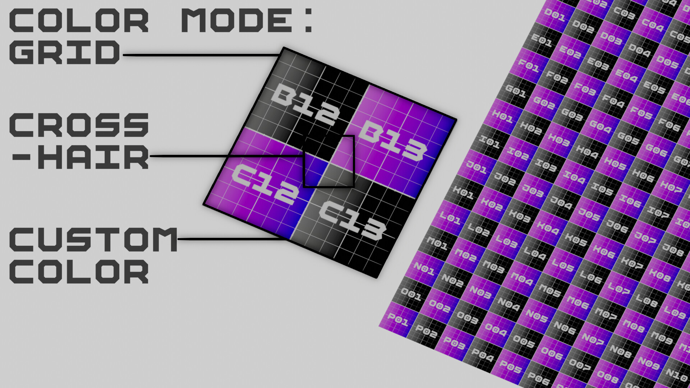
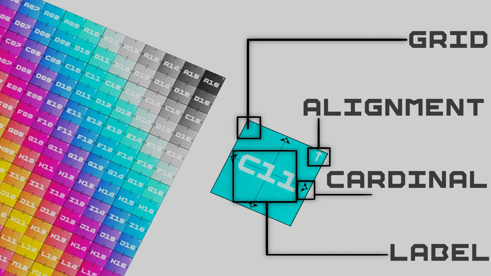
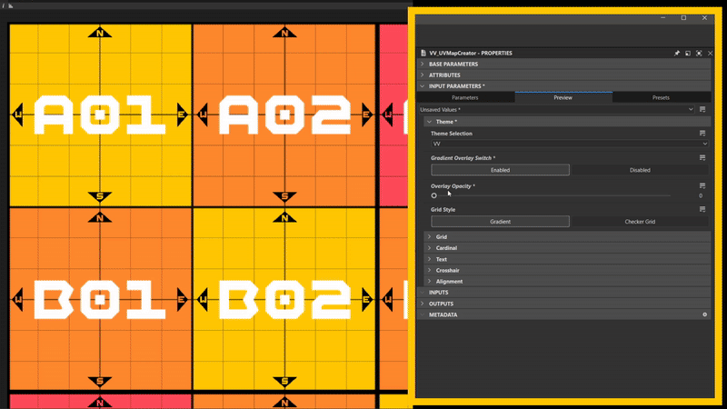
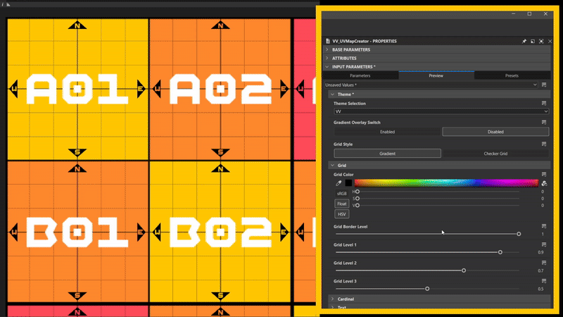
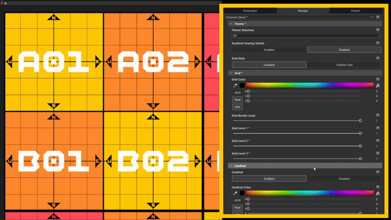
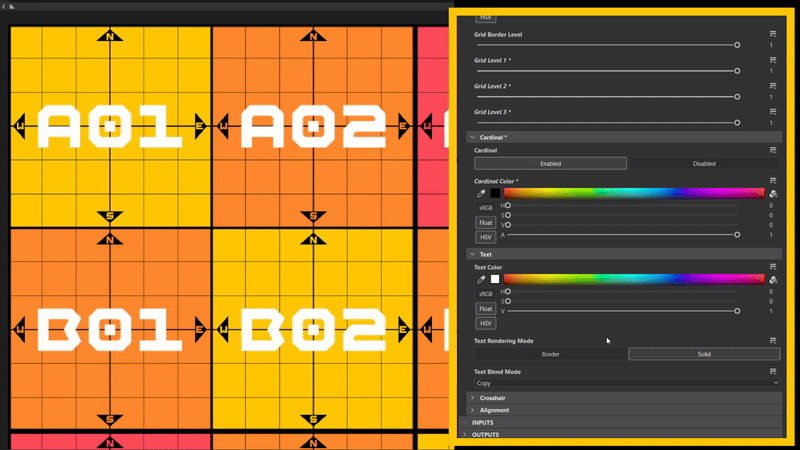
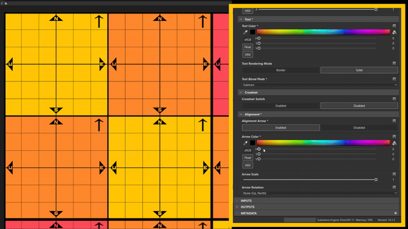

# VV UVTex Creator

UV texture creator built in Substance Designer.

 [Download](https://github.com/Vianvolaeus/vv-uvtex/releases) `.sbsar` and/or preset textures from releases

---

## Texture features

## Gradient overlay

Overlay a color gradient on the UV texture.

## Grid levels / octaves

Tweakable opacity of grid depth

## Cardinals

NESW directional indicators.

## Text

Cell name / number / indicator

## Alignment

Arrow indicator. Tweakable scale / direction, though you probably just want this to be "up"!

---

## Contents

| Path                                               | Description                                               |
| -------------------------------------------------- | --------------------------------------------------------- |
| [`VV_UVTexCreator.sbsar`](./VV_UVTexCreator.sbsar) | Substance archive - drop into Designer / Painter / Player |
| [`Presets (Textures)`](./Presets%20(Textures)/)    | Pre-exported textures from the `.sbsar`'s presets         |

## Usage

- Download the repo or latest [release](https://github.com/Vianvolaeus/vv-uvtex/releases)
- Open `VV_UVTexCreator.sbsar` in Substance 3D Designer or Substance Player
- Tweak parameters — grid levels, cardinals, text, alignment, gradient overlay, etc.
  - Presets, as seen in the preexported textures, are available in the `.sbsar` itsel
